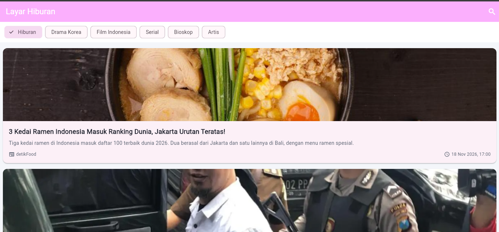
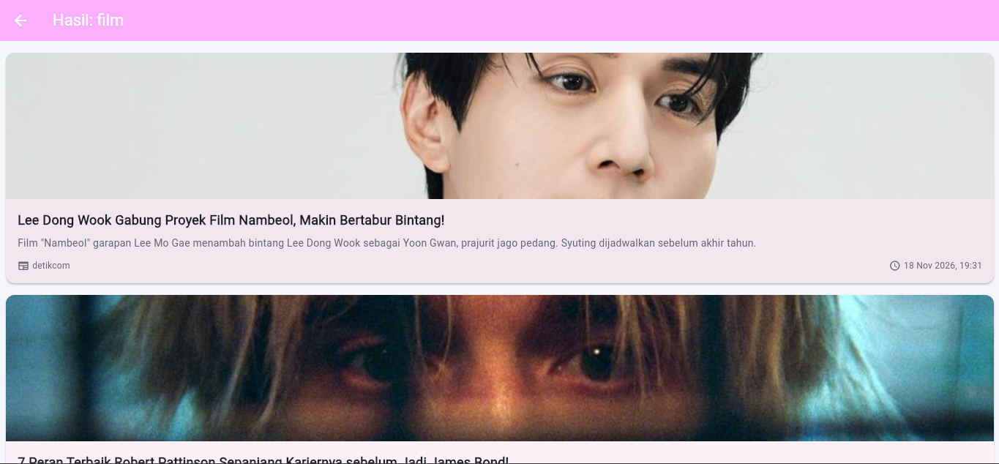
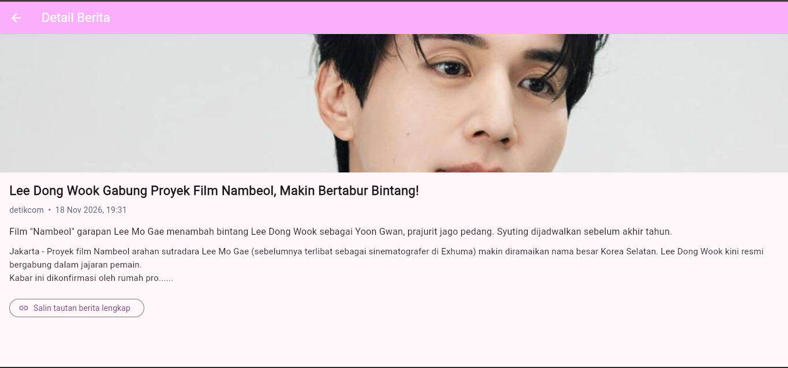
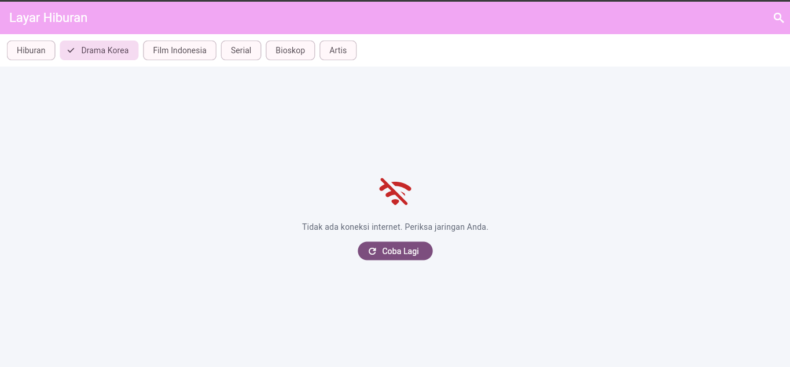
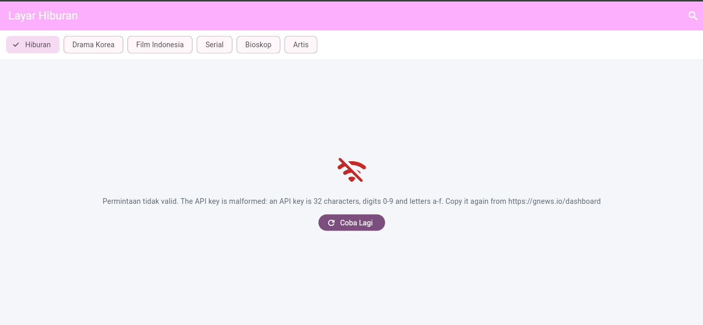

# Layar Hiburan

Aplikasi berita hiburan (drama dan film) Indonesia berbasis Flutter. Data diambil dari GNews API memakai Dio, ditampilkan dengan FutureBuilder, dan setiap kegagalan jaringan ditangani dengan pesan error yang jelas lewat `ApiException`.

Tugas mata kuliah Pemrograman Mobile (Flutter), Topik 11: FutureBuilder, News App, dan Error Handling API.

## Fitur

- Daftar berita dengan `FutureBuilder` dan empat state: loading, error, kosong, data
- Chip topik: kategori (`/top-headlines`) dan kata kunci (`/search`): Hiburan, Drama Korea, Film Indonesia, Serial, Bioskop, Artis
- Fitur cari: ikon di AppBar membuka dialog, hasil tampil di halaman baru dengan `FutureBuilder`
- Hemat kuota: hasil tiap topik disimpan di `Map<String, Future<List<ArticleModel>>>`, kembali ke chip yang sama tidak memicu request baru
- Halaman detail berita, pull-to-refresh, dan tombol Coba Lagi
- `ApiException` dengan pesan berbeda untuk tiap jenis error

## Cara menjalankan

1. Salin `config/env.example.json` menjadi `config/env.json`, lalu isi `GNEWS_API_KEY` dengan API key dari gnews.io.
2. Jalankan `flutter pub get`.
3. Jalankan `flutter run -d chrome --dart-define-from-file=config/env.json`.

File `config/env.json` masuk `.gitignore` sehingga API key tidak ikut ke repository.

## Struktur kode

- `lib/config`: pembacaan URL dan API key (`env.dart`)
- `lib/models`: `article_model`, `news_response_model`, `news_topic`
- `lib/services`: `api_exception`, `news_api_service`
- `lib/views`: `home_view`, `search_result_view`, `detail_view`
- `lib/widgets`: `article_card`, `news_future_list`, `error_view`, `news_image`, `search_dialog`
- `lib/controllers`: `detail_controller`
- `lib/routes`: `app_pages`, `app_routes`
- `lib/utils`: `app_colors`, `date_formatter`

## Screenshot

| Beranda                          | Pencarian                            | Detail                            |
| -------------------------------- | ------------------------------------ | --------------------------------- |
|  |  |  |

### Skenario error

| Tidak ada koneksi internet                      | API key salah (401)                     |
| ----------------------------------------------- | --------------------------------------- |
|  |  |
